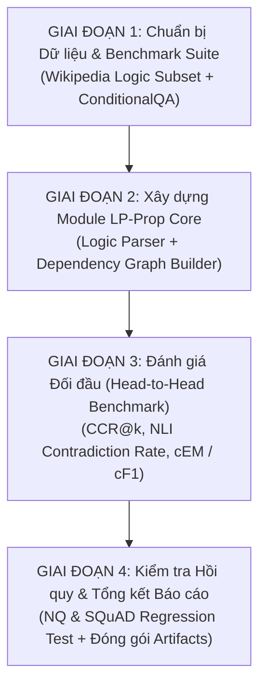

# Kế Hoạch Thực Nghiệm Chi Tiết (Experimental Plan) — Đề Xuất LP-Prop
**Dự án:** LP-Prop (Logic-Preserving Proposition Retrieval)  
**Mục tiêu:** Kiểm chứng và lượng hóa sự cải tiến của LP-Prop so với Standard Propositionizer (Chen et al., 2024)  
**Môi trường phần cứng mục tiêu:** Kaggle Notebook (1x GPU T4 16GB VRAM, 30h quota/tuần) / Local GPU  
**Ngày lập:** 14/10/2026  

---

## TỔNG QUAN LỘ TRÌNH 4 GIAI ĐOẠN



---

## GIAI ĐOẠN 1: THIẾT LẬP DỮ LIỆU & BENCHMARK SUITE
*(Thời gian dự kiến: 1 – 2 ngày | Tài nguyên: CPU)*

### Bước 1.1: Đóng gói Tập Benchmark Nội bộ từ Corpus 8,000 bài hiện tại
* **Tên tập dữ liệu:** `Wiki-Logic-864` (Được trích từ `results_run_2/densex/corpus`).
* **Quy mô:**
  * 864 đoạn văn Wikipedia chứa các từ nối logic (`unless`, `except that/in`, `provided that`, `only if`, `as long as`).
  * 164 ca lỗi logic đã được kiểm chứng độc lập trong file `potential_logic_errors.csv`.
* **Hành động kỹ thuật:**
  * Tạo bộ câu hỏi kiểm chứng (Verification Query Suite) gồm:
    * 100 câu hỏi trắc nghiệm / Yes-No nhắm thẳng vào các điều kiện bị cắt cụt (ví dụ: *"Can unconstitutional treaties become law in Mongolia?"* $\to$ Gold Answer: *"No"*).
    * Gắn nhãn câu trả lời đúng (Gold Answer) và điều kiện bắt buộc (Gold Constraint).
* **Đầu ra:** File `data/wiki_logic_eval_100q.jsonl`.

### Bước 1.2: Chuẩn bị Bộ dữ liệu Chuẩn Quốc tế `ConditionalQA`
* **Nguồn:** `google-research-datasets` / GitHub chính thức của Sun et al. (ACL 2022).
* **Quy mô:**
  * Corpus: ~2,016 tài liệu chính sách công của chính phủ Anh (`gov.uk`).
  * Questions: 1,000 câu hỏi trong tập `dev` (đều có câu trả lời phụ thuộc vào điều kiện).
* **Hành động kỹ thuật:**
  * Chuyển đổi định dạng corpus `gov.uk` thành định dạng `passage.jsonl` tương thích với pipeline của nhóm.
  * Trích xuất các nhãn bằng chứng điều kiện (evidence condition spans).
* **Đầu ra:** Thư mục `data/conditionalqa_corpus/` (~45 MB, cực kỳ nhẹ).

---

## GIAI ĐOẠN 2: HIỆN THỰC HÓA MODULE LP-PROP CORE
*(Thời gian dự kiến: 2 – 3 ngày | Tài nguyên: GPU T4)*

```text
               Passage gốc: "B unless A"
                        │
                        ▼
   [ Bước 2.1: Bộ phân tích Cú pháp & Logic ]
     (spaCy Dependency Parser + Pattern Rules)
      - Trích xuất: Core Fact (B) & Condition (A)
      - Gán nhãn quan hệ: r = EXCEPT
                        │
                        ▼
   [ Bước 2.2: Xây dựng Đồ thị Tri thức Cục bộ ]
      - Nút: v_1 (B) và v_2 (A) ∈ R^768 (Contriever)
      - Cạnh: v_1 ──[EXCEPT]──► v_2
      - Lưu Metadata Index: UNIT_LOGIC_EDGES = {id_1: [(id_2, 'EXCEPT')]}
                        │
                        ▼
   [ Bước 2.3: Toán tử Mở rộng Ngữ cảnh (Context Expansion) ]
      - Khi Retrieve được v_1: Tự động gom thêm v_2
      - Đóng gói Prompt: "B [TRỪ KHI: A]" nạp vào Reader
```

### Bước 2.1: Logic-Aware Proposition Decomposer
* **Nhiệm vụ:** Thay vì dùng Propositionizer thuần cắt rời câu, ta dùng một bộ lọc quy tắc cú pháp nhẹ (Lightweight Dependency Parser) nhận diện các mệnh đề phụ thuộc trạng ngữ (`advcl:condition`).
* **Đầu vào:** Passage text.
* **Đầu ra:** Danh sách proposition nguyên tử kèm **cặp chỉ số phụ thuộc** $(p_i, p_j, \text{relation})$.

### Bước 2.2: Xây dựng Logic Graph Index
* **Mở rộng cấu trúc Index hiện tại:**
  * Giữ nguyên ma trận vector $\mathbf{C} \in \mathbb{R}^{N \times 768}$ và mảng `UNIT_PIDX`.
  * Bổ sung một mảng ánh xạ đồ thị: `UNIT_EDGES` (Lưu danh sách kề các cạnh logic dạng `int32`, chi phí RAM < 10 MB).

### Bước 2.3: Toán tử Truy xuất Mở rộng (Retrieval-time Context Expansion)
* Thuật toán: Khi tìm ra top-$k$ propositions có điểm tương đồng cao nhất:
  $$\forall p \in \text{Top-}k: \quad \text{Context}(p) = p \cup \text{Neighbors}(p)$$
* Nếu $p$ có cạnh `EXCEPT` hoặc `COND` trỏ tới $p'$, $p'$ sẽ tự động được kéo kèm vào context với chi phí token tối thiểu (~15-20 từ).

---

## GIAI ĐOẠN 3: ĐÁNH GIÁ ĐỐI ĐẦU (HEAD-TO-HEAD BENCHMARK)
*(Thời gian dự kiến: 2 ngày | Tài nguyên: GPU T4)*

Tiến hành chạy thực nghiệm trên **4 hệ thống đối đầu**:
1. `Passage Retrieval`: Contriever trên đoạn 100 từ nguyên bản.
2. `Sentence Retrieval`: Contriever trên các câu tách bằng NLTK.
3. `Standard Proposition`: Mô hình của Chen et al. (2024).
4. `LP-Prop (Đề xuất)`: Mô hình của nhóm với cơ chế Logic Graph Expansion.

### Bảng Chỉ số Đo lường (Evaluation Metrics):

| Chỉ số (Metric) | Mức độ | Định nghĩa & Mục tiêu cải tiến |
| :--- | :---: | :--- |
| **CCR@5 / CCR@20**<br>*(Condition Completeness Rate)* | Retrieval | Tỷ lệ % các điều kiện tiên quyết được lấy về đủ cùng mệnh đề chính.<br>🎯 **Mục tiêu: LP-Prop đạt >95% (so với ~65% của Chen et al.).** |
| **CR**<br>*(NLI Contradiction Rate)* | Logic Fidelity | Tỷ lệ context RAG mâu thuẫn/lật ngược nghĩa đoạn văn gốc (đo bằng `roberta-large-mnli`).<br>🎯 **Mục tiêu: Giảm từ 19.0% xuống < 2.0%.** |
| **Conditional EM (cEM)** | Downstream QA | Tỷ lệ câu trả lời của LLaMA-2 đúng **cả kết quả lẫn điều kiện ràng buộc** trên ConditionalQA.<br>🎯 **Mục tiêu: Vượt trội ít nhất +4.0 điểm EM.** |
| **Recall@Budget (200 words)** | Hiệu năng | Đảm bảo lượng từ nạp vào LLM vẫn ngắn gọn, không bị phình to như Passage. |

---

## GIAI ĐOẠN 4: KIỂM TRA HỒI QUY & ĐÓNG GÓI BÁO CÁO (REGRESSION TEST)
*(Thời gian dự kiến: 1 ngày | Tài nguyên: CPU/GPU)*

### Bước 4.1: Kiểm tra Hồi quy trên NQ & SQuAD (Regression Testing)
* **Câu hỏi nghiên cứu:** *"Thêm cơ chế đồ thị logic có làm giảm độ chính xác trên các câu hỏi thông thường (không có điều kiện) hay không?"*
* **Thực nghiệm:** Chạy lại 500 câu NQ và 500 câu SQuAD của Run 1 & Run 2 với LP-Prop.
* **Kỳ vọng:** Điểm Recall@k (Table 3) và EM (Table 4, 5) giữ nguyên ($\pm 0.2\%$), chứng minh phương pháp **chỉ kích hoạt mở rộng khi thực sự có ràng buộc logic**.

### Bước 4.2: Đóng gói Kết quả & Viết Báo cáo
* Xuất toàn bộ bảng số liệu ra thư mục mới: `results/06_lp_prop_benchmark/`.
* Tự động sinh biểu đồ so sánh:
  * `figure_contradiction_reduction.png`: So sánh tỷ lệ lỗi logic giữa Chen et al. và LP-Prop.
  * `figure_conditional_qa_em.png`: So sánh điểm hỏi đáp có điều kiện.

---

## TỔNG KẾT TÀI NGUYÊN & TIẾN ĐỘ THỰC HIỆN

| Giai đoạn | Nhiệm vụ chính | Dataset chính | Thời gian chạy GPU | Sản phẩm đầu ra |
| :---: | :--- | :--- | :---: | :--- |
| **Giai đoạn 1** | Lọc tập lỗi Wiki-864 & nạp ConditionalQA | Wiki 8k + gov.uk | 0 giờ (CPU) | `wiki_logic_eval.jsonl`, `cqa_corpus/` |
| **Giai đoạn 2** | Code Module Parser + Logic Graph Index | Wiki-864 + gov.uk | ~2 giờ (T4) | `lp_prop_index.py`, `graph_builder.py` |
| **Giai đoạn 3** | Chạy 4 Baseline đối đầu & Đo NLI / cEM | Wiki-864 + ConditionalQA | ~4 giờ (T4) | Bảng so sánh CCR, Contradiction Rate, cEM |
| **Giai đoạn 4** | Regression test NQ/SQuAD & Vẽ biểu đồ | NQ + SQuAD 500q | ~2 giờ (T4) | Báo cáo hoàn chỉnh + Artifacts đóng gói |

👉 **Tổng thời gian GPU ước tính:** ~**8 giờ chạy trên Kaggle T4** (Hoàn toàn nằm trong hạn mức 30h miễn phí/tuần của 1 tài khoản Kaggle!).
