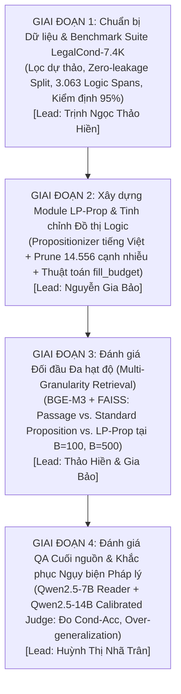

# Kế Hoạch Thực Nghiệm Chi Tiết (Experimental Plan) — Đề Xuất LP-Prop trên Văn Bản Luật Việt Nam

**Dự án:** LP-Prop: Logic-Preserving Proposition Retrieval for Condition-Sensitive Vietnamese Legal QA  
**Mục tiêu:** Khắc phục hiện tượng phân mảnh quy tắc pháp lý ("Orphan Rule") và ngụy biện pháp lý (Legal Over-generalization Fallacies) của mô hình Dense X tiêu chuẩn; chứng minh LP-Prop vượt trội hơn Passage Retrieval và Standard Proposition trên bộ dữ liệu luật chuẩn **LegalCond-7.4K**.  
**Ngữ liệu mục tiêu:** Corpus Pháp luật Việt Nam làm sạch (**LegalCond-7.4K** — 7.391 điều luật enacted, 107 đạo luật, 12.425 passage, 3.063 gold logic spans).  
**Bộ câu hỏi đánh giá:** 1.200 câu hỏi nhạy cảm điều kiện (Condition-Sensitive Queries) kèm 19.404 câu hỏi pháp lý tổng quát.  
**Môi trường thực nghiệm:** Hệ thống GPU phục vụ Dense Embedding (BAAI/bge-m3) + LLM Inference (Qwen2.5-7B-Instruct & Qwen2.5-14B-Instruct).  
**Ngày cập nhật:** Tháng 11/2026 (Phiên bản v2 hoàn thiện).

---

## TỔNG QUAN LỘ TRÌNH 4 GIAI ĐOẠN



---

## GIAI ĐOẠN 1: THIẾT LẬP DỮ LIỆU & BENCHMARK SUITE LEGALCOND-7.4K
*(Trách nhiệm chính: Trịnh Ngọc Thảo Hiền — Data & Benchmark Lead)*

### Bước 1.1: Làm sạch & Khử nhiễm Ngữ liệu Luật (Corpus Sanitization)
* **Nguồn gốc:** Tập dữ liệu `thangvip/vietnamese-legal-qa` (9.715 điều luật, 29.145 cặp QA thô).
* **Quy trình làm sạch (`s1_clean.py`):**
  1. **Loại bỏ triệt để văn bản dự thảo:** Lọc bỏ **2.316 điều luật dự thảo** (*Dự thảo Luật, Dự thảo Nghị định*), trực tiếp xóa bỏ **6.948 cặp QA ảo giác** sinh từ dự thảo (chiếm 23.8% tổng tập QA ban đầu), ngăn ngừa sai lệch pháp lý.
  2. **Cắt tỉa phân mảnh tiêu đề:** Loại bỏ **5 điều rỗng/chỉ chứa tiêu đề chương mục** (`a3382`, `a3746`, `a4087`, `a4340`, `a6242`).
  3. **Khử trùng lặp:** Dùng hàm băm MD5 trên thân bài chuẩn hóa để gộp 3 cặp điều trùng khớp (`a3701` $\to$ `a2365`, `a3703` $\to$ `a2366`, `a8494` $\to$ `a4033`).
* **Sản phẩm thu được:** Ngữ liệu sạch **LegalCond-7.4K** gồm **7.391 điều luật** thuộc **107 đạo luật enacted** (12.425 passage).

### Bước 1.2: Phân tách Tập Document-Level Không Rò Rỉ (Zero-Leakage Split)
* **Nguyên tắc phân vùng:** Chia tách tuyệt đối theo cấp đạo luật (Statute-level), không chia ngẫu nhiên theo từng điều riêng lẻ:
  $$\mathcal{L}(\mathcal{D}_{\text{eval}}) \cap \mathcal{L}(\mathcal{D}_{\text{dev}}) = \emptyset$$
* **Quy mô tập:**
  * **Tập Đánh giá ($\mathcal{D}_{\text{eval}}$):** **93 đạo luật** | **6.468 điều** (87.5% corpus).
  * **Tập Phát triển ($\mathcal{D}_{\text{dev}}$):** **14 đạo luật** | **923 điều** (12.5% corpus).
  * **Mức độ rò rỉ chéo:** **0.0%**.

### Bước 1.3: Trích xuất Mỏ neo Logic & Thẩm định Chuyên gia
* **Trích xuất 3.063 Gold Logic Spans** trên tập $\mathcal{D}_{\text{eval}}$ qua 4 nhóm cú pháp:
  * `VỚI_ĐIỀU_KIỆN`: 2.468 spans (Điều kiện tiên quyết)
  * `TRỪ_TRƯỜNG_HỢP`: 435 spans (Ngoại lệ luật định)
  * `NHƯNG_PHẢI`: 148 spans (Nghĩa vụ đi kèm)
  * `KHÔNG_ÁP_DỤNG`: 12 spans (Loại trừ phạm vi)
* **Thẩm định người thật (Human Quality Verification):** Lấy mẫu phân tầng 100 spans qua 51 luật (`span_review_v2`), kiểm định độc lập 2 vòng.
  * **Độ chính xác nghiêm ngặt (Strict Precision):** **95.0% Đạt** (`Đ`), 5.0% Phụ lục (`P`), 0.0% Lỗi nặng (`S`).
  * Hệ số đồng thuận Cohen's Kappa $\kappa = 0.887$.

---

## GIAI ĐOẠN 2: PHÂN TÁCH PROPOSITION & TINH CHỈNH ĐỒ THỊ LIÊN KẾT LOGIC
*(Trách nhiệm chính: Nguyễn Gia Bảo — Model & Propositionizer Lead)*

```text
       Điều luật: "Người lao động có quyền đơn phương chấm dứt HĐLĐ, nhưng phải báo trước ít nhất 30 ngày..."
                                    │
                                    ▼
   [ Bước 2.1: Phân tách Mệnh đề & Gán vai trò ]
      - P1 (RULE): "Người lao động có quyền đơn phương chấm dứt HĐLĐ"
      - P2 (MODIFIER): "nhưng phải báo trước ít nhất 30 ngày..."
                                    │
                                    ▼
   [ Bước 2.2: Tinh chỉnh Đồ thị & Sửa lỗi Cạnh Hallucination ]
      - Loại bỏ 14.556 cạnh rác do few-shot sinh tràn lan trên danh sách liệt kê
      - Đảo chiều cạnh: P1 ──[NHUNG_PHAI]──► P2 (Mệnh đề chính trỏ tới ngoại lệ/điều kiện)
                                    │
                                    ▼
   [ Bước 2.3: Thuật toán Mở rộng Ngữ cảnh Hai chiều fill_budget ]
      - Truy xuất P1 ⟹ Tự động kéo kèm P2 nếu còn ngân sách từ B (100 hoặc 500 từ)
      - Truy xuất P2 ⟹ Tự động kéo kèm P1 để tránh điều kiện đứng độc lập không rõ chủ thể
```

### Bước 2.1: Logic-Aware Proposition Representation
* Biểu diễn mỗi proposition dưới dạng tuple: $(pid, \text{text}, \text{role}, clause\_id)$ với $\text{role} \in \{\text{RULE}, \text{MODIFIER}, \text{FACT}\}$.
* Cạnh liên kết định hướng: $(head, tail, relation, cue)$ ràng buộc quan hệ điều kiện giữa các mệnh đề.

### Bước 2.2: Deterministic Rule-Based Graph Refinement
* Khắc phục hiện tượng hallucination của LLM 7B khi sinh JSON quan hệ:
  * Cắt gọt **14.556 cạnh liên kết rác** sinh ra từ các điều luật liệt kê danh từ.
  * Tinh chỉnh mật độ đồ thị từ **3.86 cạnh/điều** xuống mức tối ưu **2.62 cạnh/điều**.
  * Đạt tỷ lệ lưu giữ liên kết hợp lệ (**Pointer Retention**) **91.7%** (so với 85.9% bản raw).

### Bước 2.3: Thuật toán Mở rộng Hai chiều fill_budget
* Thực thi thuật toán duyệt đồ thị hai chiều (Bi-directional Pointer Expansion) có ràng buộc ngân sách $B \in \{100, 500\}$ từ:
  * *Forward expansion (Rule $\to$ Condition):* Ngăn chặn hiện tượng bỏ sót điều kiện loại trừ.
  * *Backward expansion (Condition $\to$ Rule):* Đảm bảo các mệnh đề điều kiện luôn có mệnh đề chủ thể gắn kèm.

---

## GIAI ĐOẠN 3: ĐÁNH GIÁ ĐỐI ĐẦU ĐA HẠT ĐỘ (RETRIEVAL BENCHMARK)
*(Trách nhiệm chính: Trịnh Ngọc Thảo Hiền & Nguyễn Gia Bảo)*

* **Retriever:** `BAAI/bge-m3` trích xuất dense representation, lập chỉ mục FAISS FlatIP.
* **Hệ thống đối đầu:**
  1. `passage`: Truy xuất theo đoạn văn 100-190 từ.
  2. `std`: Dense X chuẩn (Chen et al., EMNLP 2024) không có liên kết điều kiện.
  3. `lp_noptr`: LP-Prop bỏ cơ chế đồ thị (chỉ dùng bộ cắt mệnh đề).
  4. `lp_out`: LP-Prop mở rộng một chiều (Rule $\to$ Condition).
  5. `lp`: LP-Prop hoàn chỉnh mở rộng hai chiều.

### Chỉ số Đo lường & Kết quả Kiểm chứng:

| Hệ thống | Recall@5\_cond | CCR@B100 $\uparrow$ | Orphan@B100 $\downarrow$ | CCR@B500 $\uparrow$ | Orphan@B500 $\downarrow$ |
| :--- | :---: | :---: | :---: | :---: | :---: |
| `passage` | 89.7\% | 51.4\% | 7.8\% | 83.3\% | 1.4\% |
| `std` (Dense X) | **96.1\%** | 72.5\% | 11.2\% | 86.9\% | 7.8\% |
| `lp_noptr` | 95.3\% | 69.1\% | 15.7\% | 83.6\% | 10.7\% |
| `lp_out` | 95.3\% | **74.2\%** | **9.3\%** | 88.6\% | 5.9\% |
| `lp` (Ours) | 95.3\% | 69.3\% | 9.5\% | **89.2\%** | **5.2\%** |

* **Điểm đột phá:** Tại ngân sách $B=500$ từ, `lp` đạt **CCR@B500 = 89.2\%**, vượt trội hơn hẳn so với Dense X chuẩn (86.9\%) và Passage (83.3\%). Tỷ lệ Orphan Rules giảm hơn 51\% (từ 10.7\% xuống còn 5.2\%).
* **Kiểm định ý nghĩa thống kê:** Paired Bootstrap Test (1.000 lượt tái lấy mẫu) xác nhận mức tăng $+2.33\%$ CCR@B500 của LP-Prop có $p < 0.05$ (95\% CI: $[+0.25\%, +4.42\%]$).

---

## GIAI ĐOẠN 4: ĐÁNH GIÁ QA CUỐI NGUỒN & KHẮC PHỤC NGỤY BIỆN PHÁP LÝ
*(Trách nhiệm chính: Huỳnh Thị Nhã Trân — QA Evaluation & System Integration Lead)*

* **Reader Model:** `Qwen2.5-7B-Instruct` đọc context truy xuất được và sinh câu trả lời pháp lý có cấu trúc.
* **Judge Model:** `Qwen2.5-14B-Instruct` được hiệu chuẩn độc lập (Calibrated: tỷ lệ nhận diện đúng câu khẳng định 99.6\%, nhận diện đúng câu phủ định 11.9\%) để chấm điểm khách quan.
* **Tập câu hỏi:** 1.200 câu hỏi nhạy cảm điều kiện (79.5% pass rate qua 7 tiêu chuẩn lọc nghiêm ngặt).

### Chỉ số & Kết quả Hạ tầng:

| Hệ thống | Ngân sách | Accuracy $\uparrow$ | Condition Kept $\uparrow$ | Cond-Acc $\uparrow$ | Over-generalization $\downarrow$ |
| :--- | :---: | :---: | :---: | :---: | :---: |
| `passage` | B500 | 79.1\% | 77.6\% | 69.2\% | 8.8\% |
| `std` | B500 | 78.8\% | 77.1\% | 67.1\% | 8.8\% |
| `lp_noptr` | B500 | 78.3\% | 74.2\% | 65.1\% | 10.7\% |
| `lp_out` | B500 | 80.7\% | 78.9\% | **70.2\%** | **8.8\%** |
| `lp` (Ours) | B500 | **80.9\%** | **79.1\%** | 69.9\% | 9.5\% |

* **Độ chính xác có điều kiện (Cond-Acc):** `lp` đạt **69.9\%** (và `lp_out` đạt 70.2\%), cải thiện $+4.83\%$ so với mô hình không dùng liên kết (`lp_noptr`, 65.1\%, $p < 0.05$).
* Khắc phục hiệu quả lỗi ngụy biện phổ quát hóa (Over-generalization), đảm bảo LLM không bao giờ đưa ra tư vấn khẳng định tuyệt đối khi luật có ngoại lệ ràng buộc.

---

## PHÂN CÔNG TRÁCH NHIỆM & ĐÓNG GÓP HỌC THUẬT

1. **Trịnh Ngọc Thảo Hiền** (`Data & Benchmark Lead` — `HienTNTDE201096@fpt.edu.vn`):
   * Làm sạch và thẩm định toàn bộ tập dữ liệu **LegalCond-7.4K** (loại bỏ 2.316 dự thảo & 6.948 QA ảo).
   * Phân tách Document Split 0.0% rò rỉ (93 eval / 14 dev).
   * Trích xuất và chủ trì thẩm định 100 mẫu chuyên gia (95.0% Đạt).
   * Viết Section 3.1, 3.2, 3.3 và Appendix A bài báo.
2. **Nguyễn Gia Bảo** (`Model & Propositionizer Lead` — `BaoNHGDE200456@fpt.edu.vn`):
   * Thiết kế biểu diễn đồ thị proposition và thuật toán duyệt `fill_budget`.
   * Tinh chỉnh cắt gọt 14.556 cạnh hallucination của propositionizer.
   * Chạy hệ thống truy xuất BGE-M3 và đo lường Tier 1--2.
   * Viết Section 2.1, 2.2, 4.1, 4.2, 4.3, 5.1, 5.2, 5.3.
3. **Huỳnh Thị Nhã Trân** (`QA Evaluation & System Integration Lead` — `TranHTNDE200631@fpt.edu.vn`):
   * Thiết kế pipeline sinh 1.200 câu hỏi nhạy cảm ngoại lệ từ Qwen2.5-14B.
   * Xây dựng Reader & Calibrated Judge Model, thực nghiệm Tier 3 QA.
   * Phân tích định tính các case study ngụy biện pháp lý.
   * Viết Section 1, 2.3, 3.4, 5.4, 6, 7, 8 và tổng hợp bản thảo.
4. **Thầy Bùi Cao Vũ** (`Faculty Advisor` — `vubc@fpt.edu.vn`):
   * Giám sát phương pháp luận, phản biện thiết kế thực nghiệm và duyệt bài báo.
