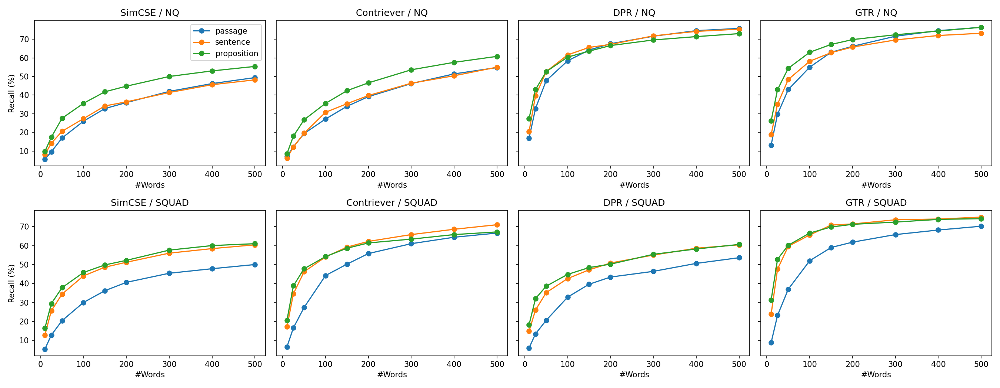

# Results Report — Dense X Retrieval Replication (SEG301)

**Paper:** [Dense X Retrieval: What Retrieval Granularity Should We Use?](https://arxiv.org/abs/2312.06648) (Chen et al., EMNLP 2024)
**Notebook:** [`notebooks/densex_replication_run1,2.ipynb`](notebooks/) · **Results:** [`results/`](results/) · **Setup:** [PLAN.md](PLAN.md)
**Comparison with the paper:** [`analysis/compare_with_paper.py`](analysis/compare_with_paper.py) → `results/paper_vs_ours.csv`, `results/trend_summary.csv`

## Summary

- **Retrieval (Table 3):** proposition beats passage on Recall in **14/16 cells** (NQ, SQuAD × 4 retrievers × R@5/R@20). The full ordering Proposition > Sentence > Passage holds in **11/16 cells** (paper: 14/16). The sign of Δ(proposition − passage) **matches the paper in all 16/16 cells**, including the 2 cells where proposition loses (DPR on NQ), where the paper also reports a loss.
- **Statistical tests:** proposition beats passage **significantly (McNemar p < 0.05) in 11/16** Recall cells and **10/16** FiD EM cells. **No cell** shows passage significantly beating proposition.
- **QA:** proposition > passage in 13/16 cells for FiD (Table 4) and in 13/16 cells for LLaMA-2-7B (Table 5). Every retrieval-augmented setting beats closed-book.
- **Difference from the paper:** absolute Recall and EM are about 5–20 points higher than in the paper because the corpus has only 8,000 pages. We therefore compare **trends**, not absolute numbers.
- **Conclusion:** the paper's main trend is reproduced. Propositions help most for **unsupervised** retrievers (SimCSE, Contriever) and on **unseen** data (SQuAD), and make almost no difference for supervised retrievers on NQ. The trend does **not** hold in 100% of cells, and neither does it in the paper.

## 1. Actual setup

| | Value |
|---|---|
| Corpus | 8,000 FactoidWiki pages = 537 gold pages (SQuAD 45, NQ 492) + 7,463 random distractors (pool of 2.2M pages, 367 shards) |
| Units | passage 78,537 · sentence 224,133 · proposition 506,413 |
| Average length | passage 62.5 words (paper 58.5) · sentence 21.9 (21.0) · proposition 11.5 (11.2) |
| Questions | 500 SQuAD v1.1 dev + 500 NQ-open test, seed 42 |
| Gold titles | 93.8% matched (SQuAD), 93.3% (NQ); missing titles are listed in `missing_titles_*.csv` |
| Answer present in corpus | NQ 90.0% · SQuAD 90.2% (`answer_coverage.csv`) |
| Leakage control | removed 8 SQuAD dev questions duplicated in train; no NQ overlap; SQuAD dev titles ∩ train titles = ∅ |
| FiD sanity check | oracle EM on 100 NQ questions = 57.0 (`fid_sanity.json`) → checkpoint loaded correctly |

**Why 8,000 pages:** the paper's full corpus has 6M pages and 257M propositions. Encoding that with 4 retrievers × 3 granularities is far beyond the Kaggle GPU quota (T4×2, 30h/week) and disk limit. With 8,000 pages, ~506k propositions × 4 retrievers in fp16 is about 3 GB, and the whole pipeline fits in 2 sessions.

## 2. Retrieval — Table 3 (Passage Recall@k)

Data: `table3_recall.csv`, `trend_check.csv`, `paper_vs_ours.csv`

| Retriever | Granularity | NQ R@5 | NQ R@20 | SQuAD R@5 | SQuAD R@20 |
|---|---|---|---|---|---|
| SimCSE | passage | 39.0 | 57.6 | 45.2 | 58.6 |
| | sentence | 47.4 | 65.0 | 53.6 | 65.6 |
| | proposition | **55.2** | **71.0** | **55.0** | **67.8** |
| Contriever | passage | 48.4 | 71.2 | 62.8 | 76.8 |
| | sentence | 52.8 | 75.0 | 66.2 | 76.6 |
| | proposition | **55.6** | **75.8** | **69.8** | **77.6** |
| DPR | passage | 73.4 | 81.4 | 49.6 | 63.2 |
| | sentence | **74.2** | **81.8** | 52.4 | 66.2 |
| | proposition | 71.6 | 80.8 | **56.6** | **68.6** |
| GTR | passage | 74.2 | 81.2 | 67.6 | 75.8 |
| | sentence | 73.0 | 81.2 | 73.0 | 78.4 |
| | proposition | **74.8** | **81.6** | **75.2** | **81.8** |

**Δ(proposition − passage), paper vs ours:**

| Retriever | NQ R@5 | NQ R@20 | SQuAD R@5 | SQuAD R@20 |
|---|---|---|---|---|
| SimCSE | +12.3 / **+16.2** | +14.6 / **+13.4** | +9.2 / **+9.8** | +8.4 / **+9.2** |
| Contriever | +7.6 / **+7.2** | +6.2 / **+4.6** | +9.9 / **+7.0** | +7.9 / **+0.8** |
| DPR | −0.6 / **−1.8** | −0.3 / **−0.6** | +3.1 / **+7.0** | +3.3 / **+5.4** |
| GTR | +0.2 / **+0.6** | +1.2 / **+0.4** | +8.9 / **+7.6** | +6.9 / **+6.0** |

(paper / **ours**)

**Observations:**

1. **Unsupervised retrievers benefit the most.** SimCSE gains 9–16 points and keeps the full Prop > Sent > Pass ordering in 4/4 cells. Contriever keeps it in 3/4 cells; on SQuAD R@20 the three granularities are nearly tied (76.6–77.6).
2. **Supervised retrievers on NQ: almost no difference.** DPR (trained on NQ) and GTR (fine-tuned with NQ) have Δ within ±2 points. The paper reports the same: *"all supervised retrievers demonstrate comparable performance across three levels of retrieval granularity in NQ, TQA, and WebQ"*, and attributes it to these retrievers being trained on query–passage pairs. The two DPR/NQ cells where proposition loses **reproduce the paper**; they are not a bug.
3. **On SQuAD, proposition wins for all 4 retrievers** (+6 to +10 points at R@5), including the supervised ones. This supports the paper's argument that propositions help retrievers **generalize** to a different question distribution.
4. **Raw counts:** full ordering in 11/16 cells (paper 14/16), proposition > passage in 14/16, Δ sign matching the paper in 16/16. The 3 cells that "lose" the ordering compared with the paper (GTR/NQ ×2, Contriever/SQuAD R@20) all have gaps between granularities of ≤ 1.2 points, smaller than the CI width in Section 5.

Secondary metrics point the same way: MRR@100 (`mrr.csv`) for SimCSE on NQ goes 26.7 → 35.0 → 41.1 (pass → sent → prop), and Recall@1 (`recall_all_k.csv`) for GTR on SQuAD goes 48.8 → 56.6 → 60.8.

## 3. Information density — Recall@l words (Figure 4/7)

Data: `recall_at_words.csv` · Figure:

This metric checks whether the answer appears within the **first l words** of the retrieved units. It is a fairer comparison than Recall@k, because the same word budget holds more propositions (11.5 words) than passages (62.5 words).

| Retriever | Dataset | Passage @100 | Prop @100 | Δ | Passage @500 | Prop @500 | Δ |
|---|---|---|---|---|---|---|---|
| SimCSE | NQ | 26.0 | 35.6 | +9.6 | 49.4 | 55.4 | +6.0 |
| SimCSE | SQuAD | 30.0 | 45.8 | +15.8 | 50.0 | 61.0 | +11.0 |
| Contriever | NQ | 27.2 | 35.6 | +8.4 | 54.8 | 60.8 | +6.0 |
| Contriever | SQuAD | 44.2 | 54.2 | +10.0 | 66.6 | 67.2 | +0.6 |
| DPR | NQ | 58.4 | 60.4 | +2.0 | 75.8 | 73.0 | −2.8 |
| DPR | SQuAD | 32.8 | 44.8 | +12.0 | 53.6 | 60.6 | +7.0 |
| GTR | NQ | 55.0 | 63.0 | +8.0 | 76.4 | 76.4 | 0.0 |
| GTR | SQuAD | 52.0 | 66.6 | +14.6 | 70.2 | 74.2 | +4.0 |

- At **100 words**, proposition beats passage in **8/8** settings, including DPR/NQ (+2.0) and GTR/NQ (+8.0), where Recall@k showed no difference.
- As the budget grows to **500 words**, the gap narrows (8/8 → 6/8 positive cells). This matches the paper's analysis: propositions help most under a small context budget, because every retrieved word is relevant to the question. Long passages carry extra, unrelated content, so they only "catch up" when the budget is large.

## 4. Downstream QA

### 4.1 FiD T5-large — Table 4

Data: `table4_fid_em.csv`, `table4_fid_mcnemar.csv`. For each granularity, the top-5/top-20 **passages** are fed to FiD, as in the paper.

| Retriever | Granularity | NQ top5 | NQ top20 | SQuAD top5 | SQuAD top20 |
|---|---|---|---|---|---|
| SimCSE | passage → prop | 27.6 → **36.8** | 38.0 → **47.4** | 28.2 → **36.0** | 34.6 → **40.8** |
| Contriever | passage → prop | 32.8 → **38.2** | 47.2 → **48.8** | 41.0 → **46.4** | **48.8** → 48.4 |
| DPR | passage → prop | **50.8** → 48.4 | 52.8 → **53.6** | 31.0 → **35.8** | 38.0 → **42.4** |
| GTR | passage → prop | 51.0 → **52.2** | **53.4** → 53.2 | 43.8 → **50.2** | 46.6 → **50.8** |

- Proposition > passage in **13/16 cells**. The win is significant (McNemar) in 10/16 cells; no cell shows a significant loss.
- Retrieval gains carry over to QA most clearly for SimCSE (+6 to +9 EM) and on SQuAD.
- Same pattern as Table 3: DPR/NQ top5 is the only cell where proposition loses noticeably (−2.4, p = 0.096, not significant). The paper also reports −1.4 in this cell.

### 4.2 LLaMA-2-7B 4-shot — Table 5

Data: `table5_em.csv`, `qa_contains_answer.csv`. The context is truncated to a budget of 100 / 500 tokens.

| Retriever | Granularity | NQ @100 | NQ @500 | SQuAD @100 | SQuAD @500 |
|---|---|---|---|---|---|
| SimCSE | passage → prop | 31.8 → **37.0** | 33.6 → **39.8** | 20.4 → **28.4** | 28.4 → **33.4** |
| Contriever | passage → prop | **36.4** → 36.2 | **40.6** → 39.2 | 24.2 → **35.2** | 38.0 → **39.8** |
| DPR | passage → prop | 40.6 → **42.2** | 44.8 → **45.4** | 20.8 → **27.2** | 30.0 → **31.8** |
| GTR | passage → prop | 38.8 → **42.0** | **45.0** → 44.4 | 27.6 → **40.2** | 37.4 → **39.0** |
| Closed-book | — | 25.8 | 25.8 | 14.6 | 14.6 |

- **100-token budget:** proposition > passage in **7/8** cells. The advantage on SQuAD is large: +6.4 to +12.6 EM.
- **500-token budget:** proposition > passage in 6/8 cells, with smaller gaps (SQuAD only +1.6 to +5.0). This agrees with Section 3: the smaller the budget, the more the information density of propositions matters.
- The full ordering Prop > Sent > Pass holds in only 8/16 cells (paper 13/16). Sentence and proposition are usually close (< 2 EM apart), so with 500 questions their order easily flips due to noise.
- Every retrieval-augmented setting beats closed-book: +6 to +20 EM on NQ, +6 to +26 EM on SQuAD.

## 5. Statistical tests

The paper only reports mean scores. This replication adds two tests to check whether the differences are real or just noise from a 500-question sample.

### 5.1 McNemar test (paired, same 500 questions)

Data: `mcnemar_win_loss.csv` (Recall), `table4_fid_mcnemar.csv` (FiD EM). For each pair of granularities, we count questions where A is correct and B is wrong (*wins*) and vice versa (*losses*), then test whether wins ≠ losses is significant.

| Comparison (Recall@k) | Significant win | Not significant | Significant loss |
|---|---|---|---|
| proposition vs passage | **11/16** | 5/16 | **0/16** |
| sentence vs passage | 10/16 | 6/16 | 0/16 |
| proposition vs sentence | 6/16 | 10/16 | 0/16 |

Typical example (SimCSE, NQ, R@5): proposition correct – passage wrong on **109 questions**, the reverse on only **28 questions**, p < 0.0001.

The 5 non-significant cells are the 4 supervised-retriever cells on NQ (DPR, GTR) plus Contriever SQuAD R@20, which are exactly the small-Δ cells from Section 2. **No cell shows passage significantly better than proposition.**

### 5.2 Bootstrap 95% CI

Data: `bootstrap_ci.csv`. The CIs are roughly ±4 points wide (e.g. SimCSE NQ R@5: passage 39.0 [34.8, 43.2] vs proposition 55.2 [51.0, 59.6]). The two CIs **do not overlap** for SimCSE on NQ (both R@5 and R@20), but overlap almost completely for DPR/GTR on NQ. This explains why, with n = 500, differences below ~3 points are inconclusive.

## 6. Further analysis

### 6.1 Rare answers (long tail) — adapted Figure 3

Data: `recall_by_answer_frequency.csv`, `recall_by_answer_frequency.png`. The paper uses entity frequency (EntityQuestions). Here we use **the number of corpus passages containing the answer** as a proxy.

| SimCSE, R@20 | answer appears 1–2 times | ≥ 30 times |
|---|---|---|
| NQ: passage → proposition | 53.7 → 76.5 (**+22.8**) | 76.7 → 84.7 (+8.0) |

For SimCSE on NQ, the benefit of propositions is ~3× larger when the answer is rare. This is the effect the paper describes: *"retrieving by proposition shows a much larger advantage … with questions targeting less common entities"*. However, the effect is **not clear** for other retrievers and datasets (e.g. SimCSE/SQuAD: +11.5 vs +11.2), so we count it as only a **partial** reproduction. The "0" bin (~10% of questions) contains questions whose answer is not in the downscaled corpus, so Recall = 0 at every granularity.

### 6.2 By question type

Data: `recall_by_question_type.csv` (R@20, averaged over 4 retrievers). Propositions help most on **narrow factoid** questions: *when* (SQuAD 65.0 → 75.0), *where* (66.1 → 74.2), *who* (NQ 72.8 → 79.2). *how/other* questions barely change. This makes sense: a proposition is "one atomic fact", so it matches questions that ask for exactly one fact.

### 6.3 Error analysis — Table 6/7

Data: `error_cases_top1.csv`: 568 questions where the top-1 results of the 3 granularities disagree (Contriever + GTR).

| Pattern (passage / sentence / proposition) | Questions |
|---|---|
| ✗✓✓ only passage wrong | 156 |
| ✗✗✓ **only proposition correct** | 132 |
| ✓✗✗ **only passage correct** | 82 |
| ✓✓✗ only proposition wrong | 82 |
| ✓✗✓ / ✗✓✗ | 61 / 55 |

In total, proposition is correct while passage is wrong on **288 questions**, and passage is correct while proposition is wrong on **164 questions**.

Individual examples are available in `error_cases_top1.csv`.

### 6.4 Index cost

Data: `efficiency.csv`. Propositions produce **6.45×** as many units as passages. The fp16 index grows from 115 MB to 742 MB, and encoding time roughly doubles. The paper says little about this accuracy–cost trade-off, but it matters for real deployment: at 6M pages, it means 257M vectors instead of 41M.

## 7. Why absolute numbers are higher than the paper

For example, SimCSE NQ R@5 passage: ours 39.0, paper 28.8. GTR NQ R@5: ours 74.2, paper 66.3. FiD and LLaMA EM are also 5–15 points higher.

1. **Far fewer distractors:** 8,000 pages vs 6M (~0.13%). The retriever only has to separate gold pages from ~7.5k other pages instead of millions.
2. **Gold pages make up a large share:** 32–35% of units come from gold pages (`corpus_stats.csv`). In full Wikipedia this share is close to zero.
3. **Not a pipeline bug:** unit lengths match the paper (62.5 / 21.9 / 11.5 words vs 58.5 / 21.0 / 11.2), the FiD oracle sanity check reaches 57 EM, and most importantly the sign of Δ matches the paper in 16/16 Table 3 cells.

The report therefore draws conclusions only from the **relative trend between granularities**, not from absolute numbers.

## 8. Limitations

- **Small scale:** 500 questions per dataset, so CIs are about ±4 points wide and differences < 3 points are inconclusive (Section 5). The downscaled corpus makes the task easier than in reality, which may underestimate the advantage of propositions. The paper argues this advantage grows with more distractors, but we could not verify it.
- **Only 2/5 datasets** (NQ, SQuAD). No TQA, WebQ or EntityQuestions, so Figure 3 is only adapted through an answer-frequency proxy, and the paper's "Avg" column cannot be compared directly.
- **Wikipedia version mismatch:** SQuAD (2016) and NQ (2018) vs FactoidWiki (2021). ~6–7% of gold titles do not match, and ~10% of answers are no longer in the corpus.
- **Distractors** are drawn only from the 367 shards containing gold pages, so they may not represent Wikipedia as a whole.
- **DPR-multiset has seen the NQ and SQuAD train splits** (seen distribution). The paper has the same issue: it treats SQuAD as "unseen" even though DPR was fine-tuned on SQuAD.
- **FiD** uses the original checkpoint loaded into a newer transformers version (the original code requires transformers 3.0.2), so small deviations are possible.
- **We did not run the Propositionizer ourselves:** we used the authors' propositions, so we cannot assess the quality or errors of the proposition extraction step (Fig 5).

## 9. Conclusion

On a downscaled 8,000-page corpus, this replication **reproduces the main trend** of Dense X Retrieval:

- Proposition ≥ passage in most retrieval settings (14/16) and QA settings (13/16 FiD, 13/16 LLaMA), with no case of passage winning significantly.
- The benefit is concentrated on **unsupervised retrievers**, **unseen data (SQuAD)**, **small context budgets** and **rare answers**. For supervised retrievers on NQ, the three granularities are roughly equal, as in the paper.

The full ordering Proposition > Sentence > Passage **does not hold in every cell** (11/16 retrieval, 12/16 FiD, 8/16 LLaMA). This is mainly because sentence and proposition are close, and their gap falls within the noise margin of a 500-question sample.
